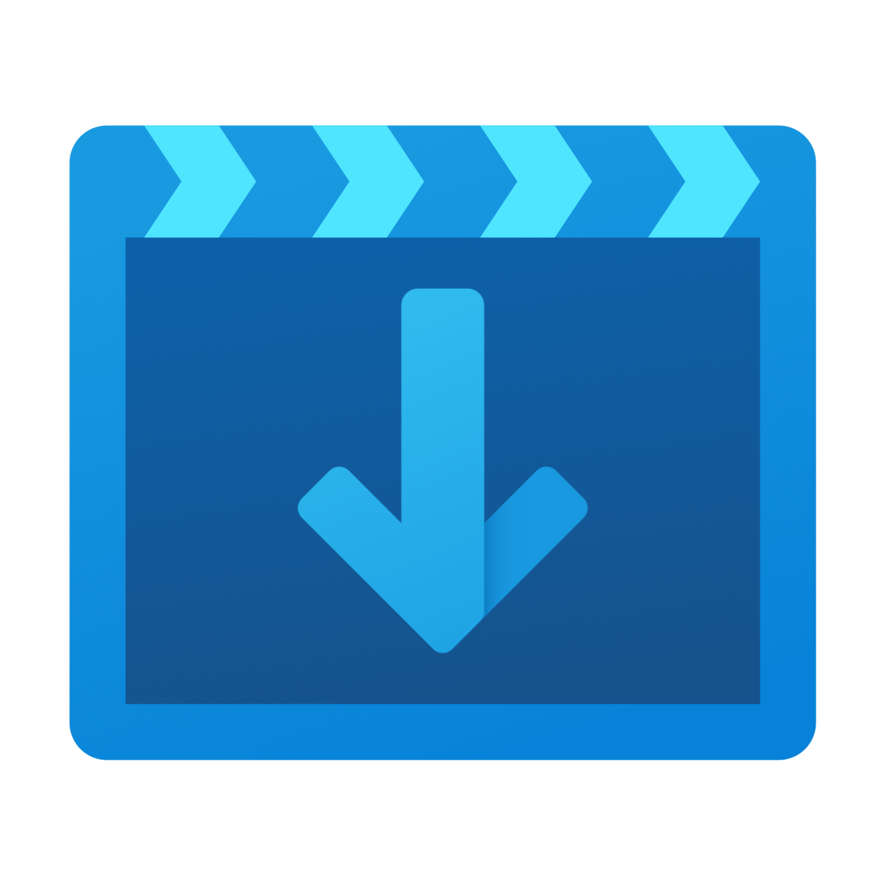
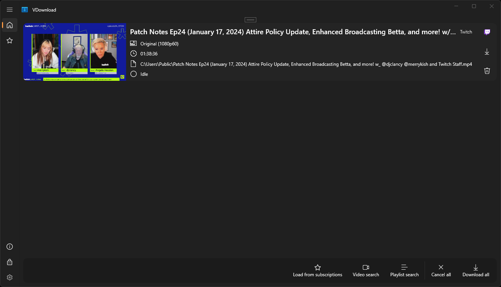

<h1 align="center">VDownload</h1>

<h3 align="center"><b>Universal video downloader, which allows you to download videos and playlists from popular video services.</b></h3>

VDownload was written in C# and Windows App SDK/WinUI 3 (formerly also with UWP framework). App allows you to download videos from social media services (only Twitch supported at the moment). At the same time, it allows you to convert videos to various formats, extract audio and video and trim length. The application has been designed to be easily extendable to support other services.

---

## Informations

> [!Important]
> **For Github users:**
>
> This is only mirror repository. All changes are first uploaded to the repository <a href="https://repos.mateuszskoczek.com/MateuszSkoczek/VDownload">here</a>. Releases are also published on original repository. However, Github repository handles issues and pull requests for better accessibility.

> [!WARNING]  
> App is no longer maintained. Last time, it was updated on February 2026. There is no guarantee that it works with newer versions of Twitch API. In fact, as of February 2026 it does not support Twitch clips. I leave the repository mainly as a sample of my work.

## Features

- Intuitive, easy to use and touchscreen friendly modern GUI, consistent with Windows 11.
- Multiple video service support - one app for all (only Twitch supported at the moment).
- Video downloading
- "Only audio" and "Only video" tracks extracting
- Time trimming - download only the fragment you need
- Playlist downloading
- Playlist filtering - download only the videos you need
- Playlist subscription - download new videos from saved playlists
- Downloading queue
- FFmpeg transcoding
- Highly configurable - from default video downloading parameters to transcoding options

## Installation and usage

Download latest package version from Releases tab and unpack it. Inside you will find all files required to run application and the application itself.  You shouldn't need to install any dependencies. Just run "VDownload.exe". You may need to accept the SmartScreen filter warning.

## Attribution

This project is open source on MIT License, so you can just copy and upload again to your repository. But according to the license, you must include information about the original author. You can find license <a href="https://repos.mateuszskoczek.com/MateuszSkoczek/VDownload/src/branch/main/LICENSE">here</a>.

**Other sources:**

- Icons by <a href="icons8.com">Icons8</a>